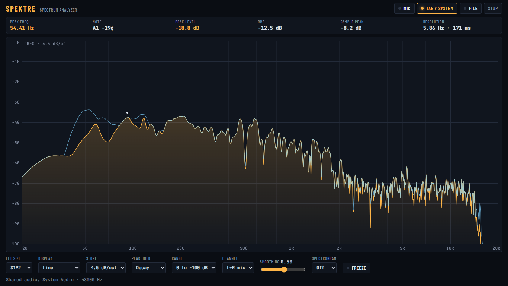
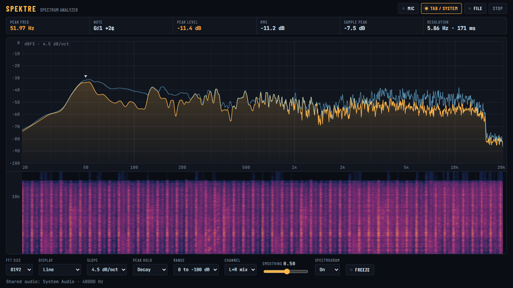

# SPEKTRE

A browser-based real-time spectrum analyzer for desktop and mobile. Plain HTML, CSS and JavaScript with no dependencies or build step.

**Live:** https://theogal.github.io/spektre/

## Sources

Choose what to analyze from the top bar:

- **Mic**: any input device. The browser's echo cancellation, noise suppression and auto-gain are switched off, so the signal stays unprocessed.
- **Tab / System**: captures audio from another browser tab or the whole system using screen sharing. Works in desktop Chrome, Edge and Opera. Tick "Share audio" in the picker.
- **File**: plays a local audio or video file through the analyzer.

## Screenshots

  
  

## Features

- **Calibrated dBFS:** a 0 dBFS sine reads 0 dB.
- **Precise peak readout:** interpolated peak frequency and level, with the note name and cents.
- **Display modes:** line, or 1/3, 1/6 and 1/12-octave bars, with optional peak hold.
- **Live stats:** RMS and sample-peak meters.
- **Resolution control:** FFT size from 2048 to 32768, with the bin resolution shown live.
- **Analysis options:** channel select (L+R, L or R), smoothing, display range, and freeze (Space).
- **Spectrogram:** an optional scrolling view under the main plot.
- **Cursor readout:** hover on desktop, or touch and drag on a phone.

## Why a 4.5 dB/oct slope by default

Music naturally carries far more energy in the low end, so a flat (unsloped) spectrum of a well-balanced mix falls steeply from left to right. That makes tonal balance hard to judge.

Tilting the display by 4.5 dB per octave, pivoting at 1 kHz, makes a balanced mix look roughly flat. It's the same convention as the default slope in Voxengo SPAN and other mixing analyzers, so readings in Spektre line up with what you're used to in a DAW.

The slope changes only the plot. The peak level and cursor readouts always show the true, unsloped dBFS. Choose 0, 3, 4.5 or 6 dB/oct in the settings.

## Defaults

The startup settings live in the `DEF` object at the top of `app.js`. Your last-used settings are saved in the browser and override them. To make changed defaults apply to every browser, including yours, change the `STORE` key.

## How to host it

Simply download the files and place them on your server. 
Microphone and tab capture require HTTPS (or localhost).
